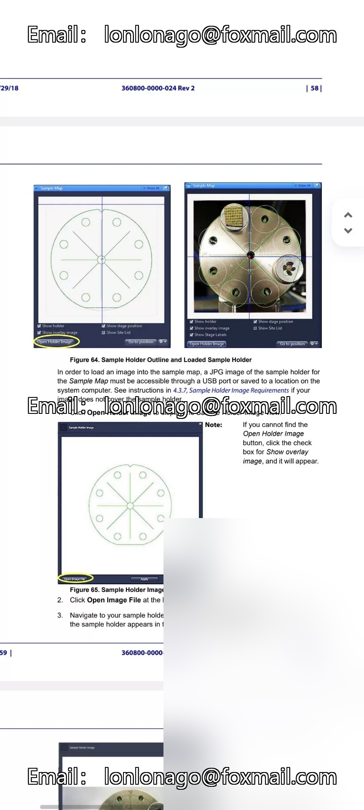
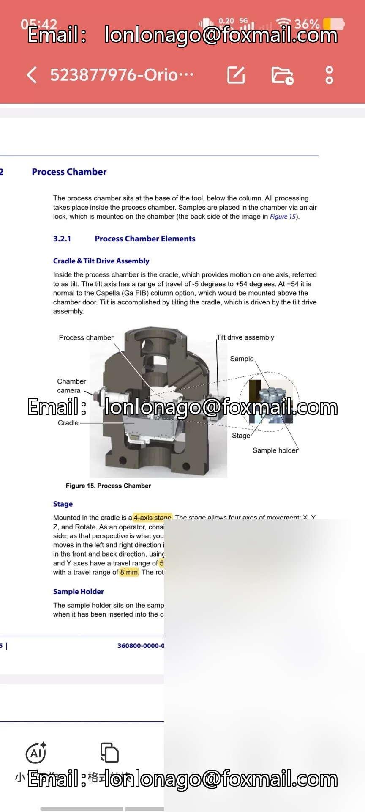
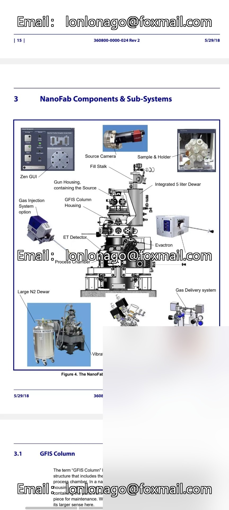

# Operation manual for Karl Zeiss ORION NanoFab multi-beam ion microscope platform

## Body

Carl Zeiss ORION NanoFab multi-beam ion microscope platform operation manual, English original version PDF, complete content, suitable for device operation, maintenance and learning reference.

The material is a PDF , shipped via network disk, and does not support returns.
976

The manual covers the Carl Zeiss ORION NanoFab multi-beam ion microscopy platform, covering operation, maintenance and learning references; it provides a PDF original that is not supported for return.

<!-- AI_ENRICHED -->

## Images

## Payment

Here is a pay link on Stripe ( https://buy.stripe.com/3cs8yP7sY87d0vu9AB ). Please contact me lonlonago@foxmail.com after funding $89, and I will send you a complete data files , thank you!

